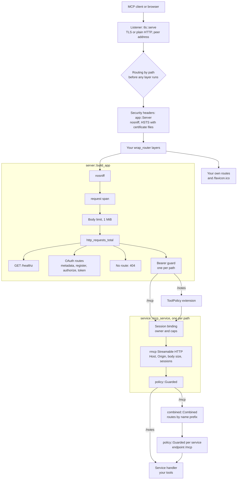
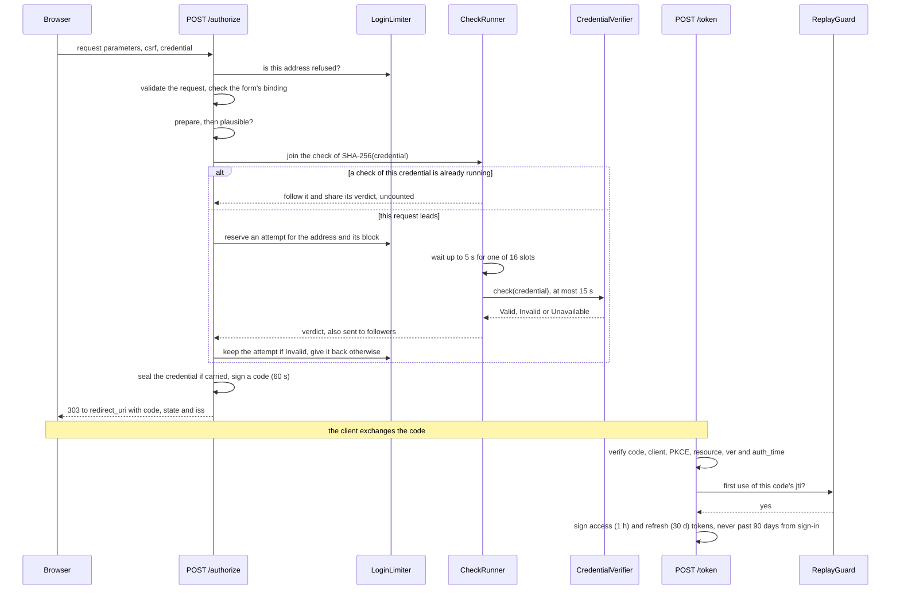
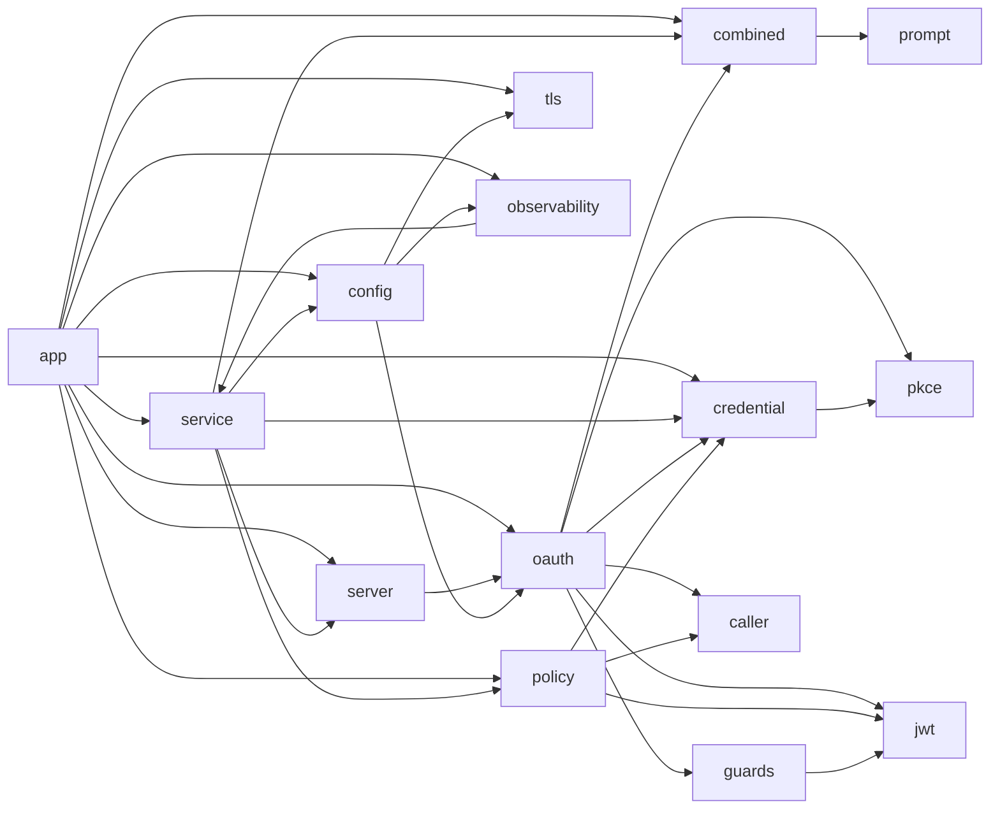

# Architecture

This page shows how the crate is put together: the layers a request passes through, what happens inside the server during a sign-in, which module is responsible for what, and the little state the server keeps in memory. It describes a server built with `app::Server`; [Lower-level API](lower-level-api.md) shows how to assemble the same pieces yourself.

## The request path

Every request passes through the layers below, from top to bottom. The response travels back up the same way, which is how the outer layers add headers to every response, refusals included.

Layer by layer, in the order a request meets them:

| # | Layer | In the code | What it does | What it refuses |
|---|---|---|---|---|
| 1 | Listener | `tls::serve` | Accepts the connection over TLS (certificate files, checked for changes every 30 seconds, or a self-signed certificate) or plain HTTP, and hands every handler the peer address as `ConnectInfo<SocketAddr>`. On shutdown, gives open connections 10 seconds. | |
| 2 | Routing | `axum::Router` | Picks the route by path first: axum runs the middleware added with `Router::layer` after routing, on the route it chose. The routes are `/healthz`, the OAuth routes from `oauth::oauth_router`, each service path nested at `/<name>`, `/favicon.ico` when the server has an icon, and yours. A path with no route goes to axum's fallback, which answers 404 through the same layers. | 404 |
| 3 | Security headers | `Server::router`, the last layer it adds | Adds `X-Content-Type-Options: nosniff` to every response, and `Strict-Transport-Security: max-age=31536000` when serving certificate files. | |
| 4 | Your layers | `Server::wrap_router` | Whatever you add, such as a request rate limiter. Routes you add here, and `/favicon.ico`, are answered at this level and skip the layers of `build_app` below. | Whatever you refuse |
| 5 | nosniff | `build_app`, its outermost layer | Adds `nosniff` again, so an application built with `build_app` alone has it too, refusals from the layers below included. | |
| 6 | Request span | `build_app`, `TraceLayer` | Opens a `request` tracing span with the method and path. | |
| 7 | Body limit | `build_app`, `RequestBodyLimitLayer` | Refuses a request whose `Content-Length` is over `BODY_LIMIT`, 1 MiB, and cuts off a longer body as it is read. axum's own default extractor limit is turned off on these routes, so this limit applies instead; rmcp reads its JSON with the same limit. | 413 |
| 8 | Request metrics | `server::http_metrics` | Counts every response that reaches it in `http_requests_total`, by matched route (`unmatched` for a path with no route) and status. | |
| 9 | Bearer guard | `oauth::require_bearer`, one per service path | Accepts an access token issued for this path whose grant still holds, the static token, or a person's own credential sent directly. Adds `Caller` to the request, `Claims` for an OAuth token and `Credential` when credentials are carried. Counts wrong static tokens and rejected credentials towards the sign-in limits. `/healthz` and the OAuth routes have no bearer guard. | 401 with `WWW-Authenticate`; 429 or 503 from the limits |
| 10 | Tool policy | `Server::router`, `axum::Extension` | Attaches the service's `ToolPolicy` (read-only or not, the audit log, the endpoint) to requests on its own path. `/mcp` has none: its policies are fixed per service in step 14. | |
| 11 | Session binding | `mcp_service` | Lets a request name an MCP session only with the credential that opened it, and caps sessions per credential and per path. | 404 `Session not found`; 503 when the table is full |
| 12 | MCP transport | rmcp's `StreamableHttpService`, configured by `mcp_service` | Checks `Host` against the `PUBLIC_URL` host and loopback names and `Origin` against the `PUBLIC_URL` origin and `ALLOWED_ORIGINS`, limits each request body it reads to 1 MiB, and keeps the MCP sessions, building a handler for each with the service's factory. | 403 for a bad `Host` or `Origin` |
| 13 | Policy wrapper | `policy::Guarded` | On a service path, reads the `ToolPolicy` from step 10: hides write tools on a read-only service, refuses calls to them, and writes an audit line for every call of a tool not marked `read_only_hint = true`. Without a policy it changes nothing. | A tool error `read_only: ...` |
| 14 | Combined endpoint | `combined::Combined`, on `/mcp` only | Lists every service's tools and prompts as `<service>_<name>` and routes each call to its service by that prefix, through a `Guarded` with that service's policy and the endpoint `/mcp`. | |
| 15 | Your handler | `Service::handler` | Your rmcp tools and prompts. The HTTP request parts in the request context carry the `Caller`, the `Claims` for an OAuth token and the `Credential` when credentials are carried; on `/mcp`, a forwarded `prompts/get` also carries the `ToolPrefix`. | Your tool errors |

Some consequences of this order:

- A request whose `Content-Length` is over 1 MiB is refused with 413 before the bearer guard looks at it, so even an unauthenticated one gets 413 rather than 401. That 413 is answered outside the request metrics, so it is not counted in `http_requests_total`.
- The bearer guard runs before the Host and Origin checks, so a request without a token gets 401 whatever its `Host`.
- Session binding runs before rmcp sees a session id, so a session opened by someone else looks exactly like one that does not exist.
- Routes added through `wrap_router` are not counted in `http_requests_total`, have no `request` span and get axum's default body limit; [Body limits](deployment.md#body-limits) shows how to limit them.

[Endpoints](endpoints.md) lists every route with its responses, and [Limits and abuse protection](limits.md) every refusal.

## A sign-in, inside the server

[OAuth and tokens](oauth.md#the-flow) follows a sign-in from the client's side. Inside the server, the person's `POST /authorize` and the client's `POST /token` that follows go like this:

What the diagram compresses:

- **Nothing is stored.** The client's registration, the form's CSRF token, the code and both tokens are JWTs signed with `OAUTH_SIGNING_KEY`. The code carries the client id, the redirect URI, the PKCE challenge, the resource, the sign-in version (`ver`), the sign-in time (`auth_time`) and, for a personal credential, the credential sealed with ChaCha20-Poly1305. Apart from the memory of used codes, the token endpoint needs nothing but the request: the code, the client id, the redirect URI and the PKCE verifier.
- **Refusals end it early.** An address the limiter refuses gets a 429 page, or 503 while the server is refusing new addresses, before any check. A rejected credential shows the form again with 401, and a check that could not run shows it with 503; neither issues a code.
- **The check runs in a task of its own**, so the attempt is settled (kept as a failure, or given back) and followers get the verdict even if the browser goes away mid-check.
- **Only a lead calls upstream.** Requests that arrive while the same credential is being checked follow that check and are not counted again, so a client cannot multiply upstream calls by sending the same credential many times.
- **A password is never carried.** With the owner's password, the code carries no credential, and tools act with the server's own upstream configuration.

The same checks guard a credential sent directly as a bearer token, in step 9 of the request path, with a [verdict cache](limits.md#verdict-cache) in front. [Sign-in modes](sign-in.md) describes the verifiers, and [Limits and abuse protection](limits.md#sign-in-attempts) what is counted.

## Module responsibilities

An arrow points from a module to one whose items it uses:

| Area | Modules | Responsible for |
|---|---|---|
| Building a binary | `app` | Command-line flags, reading and checking the whole configuration, choosing services and the sign-in verifier, assembling the application, logging startup, serving until shutdown. |
| The HTTP application | `server` | `/healthz`, merging the OAuth routes, nesting each service behind its bearer guard, the body limit, request metrics, the request span and `nosniff`. |
| Hosting MCP | `service`, `combined`, `prompt` | The `Service` trait; the hardened Streamable HTTP transport with Host and Origin checks and session binding; the combined `/mcp` endpoint that prefixes and routes names; helpers for prompts that name tools. |
| Signing people in | `oauth`, `credential`, `jwt`, `pkce`, `caller` | The authorization server's routes and the bearer guard; verifiers, sealed credentials and the shared, capped credential checks; issuing and verifying tokens; PKCE and constant-time comparison; who made each request. |
| Abuse limits | `guards` | Sign-in attempts per address, per block and overall, and the one-time use of codes. |
| Read-only mode and audit | `policy` | Hiding and refusing write tools, and recording every write call. |
| Running | `config`, `tls`, `observability` | Environment variables and their errors; listening, certificates and the healthcheck; logs, metrics and traces. |

Services never depend on each other. Anything that combines them, such as `/mcp`, lives in this crate and works from each service's name and handler alone. [Lower-level API](lower-level-api.md#module-map) lists every public item by module.

## State in memory

The server keeps no database and writes nothing to disk except the audit file. What it does keep lives in memory, per process:

| State | Where | Holds | Bounds | After a restart |
|---|---|---|---|---|
| Sign-in limits | `AuthState`, a `guards::LoginLimiter` | Attempts in the last 60 seconds per address (IPv4 address, IPv6 /64) and per block (IPv4 /24, IPv6 /48), and the times of recent rejections for the global ceiling | 10,000 addresses and 10,000 blocks; old entries swept at most once a second | Counting starts again |
| Used codes | `AuthState`, a `guards::ReplayGuard` | The `jti` of every authorization code exchanged, with its expiry | Each until it expires, plus the 5-second leeway; codes live 60 seconds | A code from before the restart could be exchanged once more within its 60 seconds, still needing the client's PKCE verifier |
| Verdict cache | `AuthState` | The SHA-256 of each credential sent as a bearer token, and whether it was accepted | 10,000 entries; accepted ones for 600 seconds, rejected ones for 60 | Credentials are checked upstream again |
| Running checks | `AuthState` | The checks in flight, by SHA-256 of the credential, and 16 slots | Only while a check runs | Nothing is lost |
| Session tables | One per path, in `mcp_service` | Each MCP session's id, the SHA-256 of the credential that opened it and when it was last used | 10,000 sessions per path and, when credentials are carried, 50 per credential; entries idle for 360 seconds swept | Clients get 404 and open a new session |
| MCP sessions | One rmcp session manager per path | The live sessions, each with its own handler built by the service's factory | Ended by rmcp after 300 seconds idle, or by session binding | As above |
| Audit file | `policy::AuditLog` | The open file, and when a failed write last warned | One handle | Reopened on the next write |
| Certificate | `tls::serve` | The current certificate and key | Reloaded when the files change | Read from the files again |
| Your services | Your handlers | Whatever your services keep, such as the notes in the `notes` example | Up to you | Up to you |

Apart from the used codes, nothing in this table is needed to accept a token. Every token is a JWT, signed with HS256 under `OAUTH_SIGNING_KEY`, and carries what the server needs to accept it: its kind, audience, expiry, client, resource, sign-in version and sign-in time, and the sealed credential. Whether a grant still holds is computed from those claims and the current configuration, never looked up. That is why:

- a restart signs nobody out, and any replica with the same configuration accepts any other replica's tokens;
- there is nothing to back up, migrate or share between replicas except the configuration;
- the server cannot revoke one person or client, or notice a refresh token used twice. [What statelessness means](oauth.md#what-statelessness-means) explains the trade-off, and [Replicas](deployment.md#replicas) what each replica keeps on its own.

## Design choices

- **One key for everything.** `OAUTH_SIGNING_KEY` signs every token, derives the key that seals credentials (HKDF-SHA256), keys the hash behind `key:` subjects, and the sign-in version. Rotating it ends every grant and every registration at once.
- **Grants end by changing their inputs.** The sign-in version is a keyed hash of the sign-in mode, the verifier's label and its generation, such as a hash of the owner's password. Changing any of them ends every earlier grant without a list of grants to revoke.
- **The limits fit the secret.** When credentials are not carried, as with the owner's password and the static token beside it, one shared secret guards everything, and reaching the global ceiling blocks everyone, so guessing from many addresses gains nothing. When they are carried, as with per-person credentials, it blocks only addresses that failed themselves, so one attacker cannot lock other people out. [The global ceiling](limits.md#the-global-ceiling) has the details.
- **Refuse cheaply, before anything costly.** Implausible credentials are refused before any upstream call, a session table that is full and was swept moments ago refuses before rmcp builds a session, and this server's own tokens, even expired ones, are never sent upstream or counted as guesses.
- **Every secret compared in constant time.** `pkce::ct_eq` compares the SHA-256 digests of both sides, so neither content nor length leaks through timing.
- **rmcp does MCP.** The crate wraps rmcp's handler and transport instead of reimplementing them. The policy wrapper forwards every `ServerHandler` method, which is why the crate pins rmcp to one minor version; see [Releases and versioning](releases.md).
- **Configuration fails whole.** Every variable is read and every problem reported in one run, and the server does not start until there are none.
