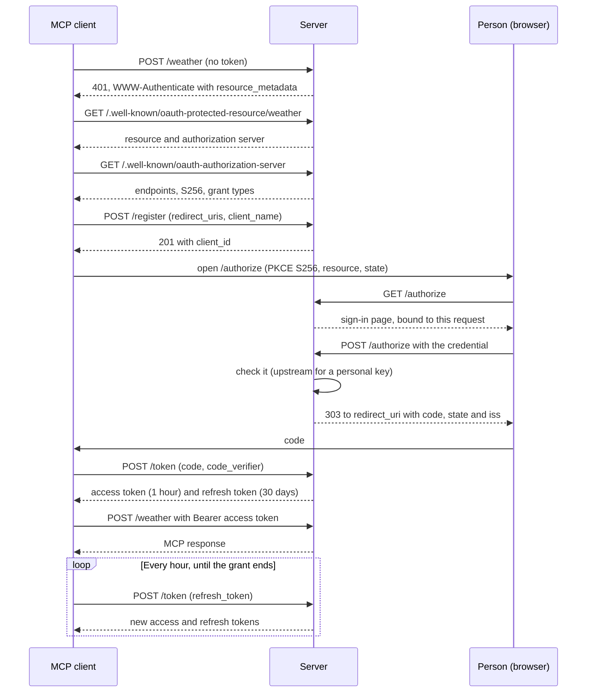

# OAuth and tokens

Every server built on mcp-server-core is its own OAuth 2.1 authorization server, built for MCP clients such as claude.ai. This page follows a sign-in from the first 401 to a refreshed token, and explains every token the server issues, how long each lasts and what ends a grant. How people prove who they are on the sign-in page is on [Sign-in modes](sign-in.md); the routes and their responses are listed on [Endpoints](endpoints.md).

## Overview

The server plays both OAuth roles. It is the authorization server that signs people in and issues tokens, and every service path is a protected resource that accepts them.

- **Standards**: OAuth 2.1 with the authorization code grant and PKCE (S256), dynamic client registration (RFC 7591), authorization-server metadata (RFC 8414), protected-resource metadata (RFC 9728), resource indicators (RFC 8707) and the `iss` authorization response parameter (RFC 9207). This is what the [MCP authorization specification](https://modelcontextprotocol.io/specification/latest/basic/authorization) asks for.
- **Public clients only**: clients register without a secret and do not authenticate at the token endpoint. PKCE protects the code instead.
- **Stateless**: client registrations, sign-in forms, codes, access tokens and refresh tokens are all HS256 JWTs signed with `OAUTH_SIGNING_KEY`. Nothing needs storing, so restarts and extra replicas sign nobody out. See [What statelessness means](#what-statelessness-means).
- **One resource per service**: each service path, and `/mcp`, is its own protected resource, and an access token works only on the path it was issued for.

## The flow

A client connecting to a service called `weather` on `https://mcp.example.com`:



The person sees one page: the sign-in form. Everything else happens between the client and the server.

## Discovery

A request to a service path without a token gets a 401 whose `WWW-Authenticate` header names the service's protected-resource metadata:

```http
HTTP/1.1 401 Unauthorized
WWW-Authenticate: Bearer resource_metadata="https://mcp.example.com/.well-known/oauth-protected-resource/weather"
```

That document names the resource (`https://mcp.example.com/weather`) and the authorization server (`https://mcp.example.com`). The authorization-server metadata at `/.well-known/oauth-authorization-server` then lists the registration, authorization and token endpoints and what they support. Every field of both documents is on [Endpoints](endpoints.md#metadata-documents).

All endpoints live at the root of `PUBLIC_URL`, which is also the issuer. `PUBLIC_URL` cannot have a path, so the well-known locations are always at the host's root.

## Dynamic client registration

A client registers itself by posting JSON to `/register`:

```http
POST /register HTTP/1.1
Host: mcp.example.com
Content-Type: application/json

{"redirect_uris": ["https://claude.ai/api/mcp/auth_callback"], "client_name": "Claude"}
```

```json
{
  "client_id": "eyJ0eXAiOiJKV1QiLCJhbGciOiJIUzI1NiJ9...",
  "client_id_issued_at": 1792317600,
  "client_name": "Claude",
  "redirect_uris": ["https://claude.ai/api/mcp/auth_callback"],
  "token_endpoint_auth_method": "none",
  "grant_types": ["authorization_code", "refresh_token"],
  "response_types": ["code"]
}
```

The answer is `201 Created`. The `client_id` is itself a signed token that holds the redirect URIs and the name, so nothing is stored and a registration never expires. It stops working only when `OAUTH_SIGNING_KEY` or `PUBLIC_URL` changes. Only `redirect_uris` and `client_name` are read; other fields of the request are ignored, and every client is public. `client_name` is `null` in the answer when none was sent.

Registration is open to anyone, so its input is capped:

| What | Limit | Error (400) |
|---|---|---|
| Body | A JSON object, sent as `Content-Type: application/json`, whose fields have the right types | `invalid_client_metadata`: `send a JSON client registration with redirect_uris` |
| Number of redirect URIs | 1 to 10; a body without `redirect_uris` has none | `invalid_redirect_uri` |
| Length of each redirect URI | at most 2,048 bytes | `invalid_redirect_uri` |
| Redirect URI scheme | `https` with a host, or `http` only on `localhost`, `127.0.0.1` or `[::1]` (native apps, RFC 8252) | `invalid_redirect_uri` |
| Redirect URI parts | no fragment, no user name or password | `invalid_redirect_uri` |
| `client_name` | optional; at most 200 characters, without control characters | `invalid_client_metadata`: `client_name must be at most 200 characters, without control characters` |

Every `invalid_redirect_uri` error has the description `redirect_uris must be 1 to 10 https URIs (http only on a loopback host), at most 2048 bytes each, without fragments or userinfo`. `client_name` is checked first. A body over the [body limit](limits.md) gets `413` instead. The caps are public as [`oauth::MAX_REDIRECT_URIS`](https://docs.rs/mcp-server-core/latest/mcp_server_core/oauth/constant.MAX_REDIRECT_URIS.html), [`MAX_REDIRECT_URI_LEN`](https://docs.rs/mcp-server-core/latest/mcp_server_core/oauth/constant.MAX_REDIRECT_URI_LEN.html) and [`MAX_CLIENT_NAME_CHARS`](https://docs.rs/mcp-server-core/latest/mcp_server_core/oauth/constant.MAX_CLIENT_NAME_CHARS.html), and [`oauth::validate_redirect_uri`](https://docs.rs/mcp-server-core/latest/mcp_server_core/oauth/fn.validate_redirect_uri.html) applies the redirect URI rules.

The client's name is self-reported. The sign-in page shows it marked as unverified, next to the host the person will be sent back to.

[Client ID Metadata Documents](https://modelcontextprotocol.io/specification/latest/basic/authorization), which the MCP authorization specification now prefers to dynamic registration, are planned.

## The authorization request

The client sends the person's browser to `/authorize` with these query parameters:

| Parameter | Required | Value |
|---|---|---|
| `response_type` | yes | `code` |
| `client_id` | yes | The `client_id` from registration. |
| `redirect_uri` | yes | Exactly one of the registered redirect URIs. |
| `code_challenge` | yes | The PKCE S256 challenge: 43 characters. |
| `code_challenge_method` | yes | `S256` |
| `state` | no | Returned unchanged with the code. An empty value counts as absent. |
| `resource` | see below | The URL of the service, such as `https://mcp.example.com/weather`, or of `/mcp`. |
| `scope` | no | Ignored: the resource decides what is granted. |

### Choosing the resource

`resource` must be exactly `PUBLIC_URL/<service>`: no trailing slash, no other host. Without it, a server with exactly one service grants that service, which keeps clients written before the 2025-06-18 MCP authorization specification working. The combined `/mcp` endpoint is never chosen by default, and a server with several services needs `resource`.

### Errors

Problems with the client or the redirect URI are shown in the browser and never redirected, because the redirect URI cannot be trusted yet:

| Problem | Response |
|---|---|
| No `client_id` | 400 page: `missing client_id` |
| `client_id` that this server did not sign | 400 page: `unknown client` |
| No `redirect_uri` | 400 page: `missing redirect_uri` |
| `redirect_uri` not registered | 400 page: `redirect_uri is not registered for this client` |

Other problems are sent back to the redirect URI with `error`, `error_description`, `state` (when there is one) and `iss`. The redirect is `302 Found` from the `GET`, and `303 See Other` when the sign-in form was posted:

| Problem | `error` | `error_description` |
|---|---|---|
| `response_type` is not `code` | `unsupported_response_type` | `response_type must be code` |
| `code_challenge_method` is not `S256` | `invalid_request` | `code_challenge_method must be S256` |
| No `code_challenge`, or not 43 characters | `invalid_request` | `code_challenge is required` |
| No `resource` on a server with several services | `invalid_target` | `resource is required: name the URL of the service, or of /mcp for every service` |
| `resource` is not a service on this server | `invalid_target` | `resource is not a service on this server` |

## The sign-in page

`GET /authorize` with a valid request shows the sign-in page. It tells the person:

- what is asking: "An MCP client is requesting access to the **weather** service on this server", or to "**every service** on this server, through `/mcp`";
- the client's name, as "self-reported, unverified", when it registered one;
- where they will be sent: "After you authorize, you will be sent to **claude.ai**.";
- what to enter, named by the verifier's label, with its help text. For a personal credential the page explains that it is checked once and kept only in encrypted form inside the connection's tokens, and turns autocomplete off. For a password it allows password managers to fill the field.

Every value on the page is HTML-escaped.

### The form is bound to its request

The form carries the request's parameters as hidden fields and a signed token (kind `csrf`) that holds a hash of the client id, redirect URI, PKCE challenge, state, granted service and resource. The token is valid for 10 minutes. When the form is posted, the server validates the request again and compares the hash in constant time, so a form cannot be replayed with any parameter changed. An expired or altered form gets a 400 page: `The login form expired or was modified. Start the connection again.`

### Page headers

Every page `/authorize` renders, the sign-in page and its error pages, is sent with:

| Header | Value | Why |
|---|---|---|
| `X-Frame-Options` | `DENY` | No other site can frame the page to trick a click. |
| `Content-Security-Policy` | `default-src 'none'; style-src 'unsafe-inline'; frame-ancestors 'none'` | No scripts, images or other loads; inline styles only; no framing. |
| `Cache-Control` | `no-store` | Nothing is cached. |
| `Referrer-Policy` | `no-referrer` | The page's URL and parameters never leak in a `Referer` header. |

A 429 or 503 page also carries `Retry-After: 30`.

### Posting the form

`POST /authorize` checks, in order: the [sign-in limits](limits.md) for the client's address, the request, the form binding, the credential's shape, and then the credential itself.

| Outcome | Response |
|---|---|
| The address is refused by the sign-in limits | 429 page (or 503 while the server refuses new addresses under heavy load), with `Retry-After: 30` |
| The input is not plausible for the verifier | 401, the page again with `That is not a <label>.` Not counted as a failed attempt. |
| The credential is rejected | 401, the page again with the verifier's reason or `That <label> was not accepted.` Counted as a failed attempt. |
| The credential could not be checked | 503, the page again with `Your <label> could not be checked right now: <why>`, and `Retry-After: 30`. Not counted. |
| The credential is accepted | `303 See Other` to the redirect URI with `code`, `state` and `iss`, and `Cache-Control: no-store` |

A successful redirect looks like this:

```http
HTTP/1.1 303 See Other
Location: https://claude.ai/api/mcp/auth_callback?code=eyJ0eXAi...&state=af0ifjsl&iss=https%3A%2F%2Fmcp.example.com
Cache-Control: no-store
```

- **303, not 302**, so no browser re-sends the form body, which holds the credential, to the client's redirect URI (RFC 9700).
- **`iss`** names this server, so a client talking to several authorization servers can tell which one answered (RFC 9207). Error redirects carry it too, and the metadata advertises it with `authorization_response_iss_parameter_supported`.
- **The code** is valid for 60 seconds and can be used once. It is bound to the client, the redirect URI, the PKCE challenge and the resource, and carries who signed in, the [sign-in version](#ver-the-sign-in-version), the [sign-in time](#auth_time-and-the-90-day-limit) and, for a personal credential, the [sealed credential](sign-in.md#sealed-credentials).

## PKCE

PKCE (RFC 7636) is required, with the S256 method only; `plain` is refused.

- The `code_challenge` sent to `/authorize` must be 43 characters, the length of a base64url SHA-256.
- The `code_verifier` sent to `/token` must be 43 to 128 characters from `A`-`Z`, `a`-`z`, `0`-`9`, `-`, `.`, `_` and `~`.
- The server computes `BASE64URL(SHA256(code_verifier))` and compares it with the challenge in constant time. A mismatch is `invalid_grant` with `PKCE verification failed`.

Because the code is useless without the verifier, which never leaves the client, an intercepted code cannot be exchanged by anyone else.

## The token endpoint

`POST /token` takes a form (`application/x-www-form-urlencoded`) with each parameter at most once. There is no client authentication: `client_id` names the client, and the code or refresh token must have been issued to it.

### Exchanging a code

| Parameter | Value |
|---|---|
| `grant_type` | `authorization_code` |
| `code` | The code from the redirect. |
| `client_id` | The client the code was issued to. |
| `code_verifier` | The PKCE verifier. |
| `redirect_uri` | The redirect URI the code was issued for. |
| `resource` | Optional. If sent, it must be the resource of the grant. |

```sh
curl -s https://mcp.example.com/token \
  -d grant_type=authorization_code \
  -d code="$CODE" \
  -d client_id="$CLIENT_ID" \
  -d code_verifier="$CODE_VERIFIER" \
  --data-urlencode redirect_uri=https://app.example.com/callback
```

### Refreshing

| Parameter | Value |
|---|---|
| `grant_type` | `refresh_token` |
| `refresh_token` | The refresh token. |
| `client_id` | The client the refresh token was issued to. |
| `resource` | Optional. If sent, it must be the resource of the grant. |

A refresh returns a new access token and a new refresh token for the same grant. The old refresh token keeps working until it expires; see [What statelessness means](#what-statelessness-means).

### The response

Both grants answer `200` with `Cache-Control: no-store`:

```json
{
  "access_token": "eyJ0eXAiOiJKV1QiLCJhbGciOiJIUzI1NiJ9...",
  "token_type": "Bearer",
  "expires_in": 3600,
  "refresh_token": "eyJ0eXAiOiJKV1QiLCJhbGciOiJIUzI1NiJ9...",
  "scope": "weather"
}
```

`scope` is the granted service's name (`mcp` for the combined endpoint). `expires_in` is 3600 unless the grant ends sooner.

### Errors

Every error is a `400` with a JSON body such as `{"error": "invalid_grant", "error_description": "sign in again"}` and `Cache-Control: no-store`:

| `error` | `error_description` | Cause |
|---|---|---|
| `invalid_request` | `send a form with grant_type and each parameter at most once` | Not a form, no `grant_type`, or a repeated parameter. |
| `unsupported_grant_type` | `use authorization_code or refresh_token` | Any other grant type. |
| `invalid_request` | `code, client_id, code_verifier and redirect_uri are required` | A parameter of the code exchange is missing. |
| `invalid_grant` | `invalid or expired code` | Not a code from this server, or older than 60 seconds. |
| `invalid_grant` | `code was issued to a different client or redirect_uri` | `client_id` or `redirect_uri` differ from the authorization request. |
| `invalid_grant` | `PKCE verification failed` | The verifier is malformed or does not match the challenge. |
| `invalid_grant` | `code already used` | The code was exchanged before. |
| `invalid_request` | `refresh_token and client_id are required` | A parameter of the refresh is missing. |
| `invalid_grant` | `invalid or expired refresh token` | Not a refresh token from this server, or expired. |
| `invalid_grant` | `refresh token has no client` | The refresh token names no client. |
| `invalid_grant` | `refresh token was issued to a different client` | `client_id` differs from the one the token was issued to. |
| `invalid_client` | `unknown client` | The `client_id` is not a registration this server signed. |
| `invalid_grant` | `grant has no resource` | The code or refresh token names no resource. |
| `invalid_target` | `resource does not match the grant` | A `resource` parameter names another resource. |
| `invalid_target` | `resource is not a service on this server` | The granted service is no longer enabled. |
| `invalid_grant` | `grant has no credential` | Personal credentials are in use, and the grant carries none that opens with the current key. |
| `invalid_grant` | `sign in again` | The grant has ended: see [What ends a grant](#what-ends-a-grant). |

A body larger than the [body limit](limits.md) gets `413` instead.

## Resource indicators and audiences

Every service is its own protected resource, `PUBLIC_URL/<service>`, and so is `/mcp` when the [combined endpoint](combined.md) is on. A person signs in for one resource at a time, and the access token's audience (`aud`) is that resource's URL:

- A token issued for `/weather` is refused on `/tides`, and on `/mcp`.
- A token issued for `/mcp` is refused on `/weather`.
- Codes, refresh tokens, registrations and form tokens have the authorization server itself, `PUBLIC_URL`, as their audience, so none of them is ever accepted on a service path.

Each connector added for a service is therefore a separate sign-in. To use every service through one sign-in, connect to `/mcp`. The OAuth `scope` follows the resource: the token response and the metadata name services, and a `scope` sent by the client is ignored.

## Tokens

The server issues five kinds of token. All are JWTs signed with HS256 under `OAUTH_SIGNING_KEY`, with `PUBLIC_URL` as issuer. The kind is in the `typ` claim, and a token of one kind is never accepted as another.

| Kind (`typ`) | Audience | Subject | Lifetime | Carries |
|---|---|---|---|---|
| `client` | `PUBLIC_URL` | `server` | none | `redirect_uris`, `client_name` |
| `csrf` | `PUBLIC_URL` | `server` | 10 minutes | `binding`: the hash of the authorization request |
| `code` | `PUBLIC_URL` | who signed in | 60 seconds, used once | `client_id`, `redirect_uri`, `code_challenge`, `scope`, `resource`, `credential`, `ver`, `auth_time` |
| `access` | `PUBLIC_URL/<service>` | who signed in | 1 hour, never past the grant | `client_id`, `scope`, `resource`, `credential`, `ver`, `auth_time` |
| `refresh` | `PUBLIC_URL` | who signed in | 30 days, never past the grant | the same as `access` |

Every token also has `iss`, `aud`, `sub`, `typ`, a random 128-bit `jti` and `iat`; every kind except `client` has `exp`. Expiry allows 5 seconds of clock skew. `credential` is present only when people sign in with their own credential, and is [sealed](sign-in.md#sealed-credentials). The subject is described under [Subjects](sign-in.md#subjects). The claims are documented on [`jwt::Claims`](https://docs.rs/mcp-server-core/latest/mcp_server_core/jwt/struct.Claims.html) and [`jwt::Payload`](https://docs.rs/mcp-server-core/latest/mcp_server_core/jwt/struct.Payload.html).

A grant is everything one sign-in leads to: its code, and every access and refresh token issued from it through refreshes. Every token of a grant carries the same `sub`, `ver` and `auth_time`.

### ver: the sign-in version

`ver` is a keyed hash, under `OAUTH_SIGNING_KEY`, of how people sign in: whether credentials are carried, the verifier's label and its generation (see [the CredentialVerifier trait](sign-in.md#the-credentialverifier-trait)). For the owner's password the generation is a hash of the password.

Every code, access and refresh token must carry the current `ver`, and must carry a sealed credential exactly when credentials are carried. Otherwise an access token is refused with 401, and a code or refresh token gets `invalid_grant` with `sign in again` (or with `grant has no credential`, when credentials are carried and the token has none that opens). So:

- changing the owner's password ends every earlier grant;
- switching sign-in mode, or to a verifier with another label or generation, ends every earlier grant;
- a token minted for one sign-in mode or upstream service is refused by a server using another, even with the same key and URL, so a sealed credential never reaches the wrong upstream.

[`AuthState::sign_in_version`](https://docs.rs/mcp-server-core/latest/mcp_server_core/oauth/struct.AuthState.html#method.sign_in_version) returns the current value, and [`oauth::sign_in_version(signing_key, verifier)`](https://docs.rs/mcp-server-core/latest/mcp_server_core/oauth/fn.sign_in_version.html) computes it without an `AuthState`.

### auth_time and the 90-day limit

`auth_time` is when the person signed in, in Unix seconds. It is set on the code and copied into every token of the grant, however often it is refreshed. A grant holds while it is less than 90 days old ([`MAX_GRANT_AGE`](https://docs.rs/mcp-server-core/latest/mcp_server_core/oauth/constant.MAX_GRANT_AGE.html)). A time ahead of this replica's clock, as another replica may set it, is accepted: only the age is checked, and `auth_time` is signed.

No token outlives its grant. An access token lasts 1 hour or until the grant ends, whichever is sooner, and a refresh token 30 days or until the grant ends. A client that refreshes at least once every 30 days stays signed in until the 90 days are up; then the person signs in again. The client keeps its registration, so a connector does not need to be added again.

## What ends a grant

| Event | Effect | What the person does |
|---|---|---|
| The access token is an hour old | 401 on the service path | Nothing: the client refreshes. |
| The client has not refreshed for 30 days | Its refresh token has expired: `invalid_grant`: `invalid or expired refresh token` | Signs in again. |
| 90 days since sign-in | The grant's last access and refresh tokens expire with it: 401 on the service path, and `invalid_grant` on refresh (`invalid or expired refresh token`, or `sign in again`). | Signs in again. |
| `OAUTH_ADMIN_PASSWORD` changes | Every grant ends (`ver` changes). | Signs in again with the new password. Connectors are not added again. |
| The sign-in mode, or the verifier's label or generation, changes | Every grant ends (`ver` changes). | Signs in again. |
| `OAUTH_SIGNING_KEY` changes | Every token, client registration and sealed credential stops working. | Clients register again: in claude.ai, remove the connector and add it again. |
| `PUBLIC_URL` changes | Every token and client registration names the old issuer and is refused. | As for a new key, at the new URL. |
| The service is no longer enabled | Its path is gone; a refresh gets `invalid_target`: `resource is not a service on this server`. | Connects to a service that is enabled. |

Restarts, extra replicas and changes to `MCP_AUTH_TOKEN` end nothing.

## What statelessness means

The server keeps no lasting record of clients, sign-ins or tokens; only codes recently exchanged are remembered, in memory. Each replica needs only the same configuration, above all the same `OAUTH_SIGNING_KEY`, and there is no database or volume to back up. The price:

- **No revoking one person or one client.** Revocation is all or nothing: rotate `OAUTH_SIGNING_KEY` (everyone signs in again and clients register again) or, with the owner's password, change the password (everyone signs in again). With personal credentials, revoking a key upstream stops it working through the server as well: the tokens still open, but the upstream service refuses the key.
- **No refresh-token reuse detection.** OAuth 2.1 asks an authorization server to notice when an old refresh token is used again and revoke the grant, which needs a record of every grant. A stolen refresh token works until it expires, the grant reaches 90 days, the owner's password changes or the key is rotated.
- **One-time codes are remembered per replica.** Each replica remembers the codes it has exchanged, in memory, until they expire. Behind several replicas, or across a restart, a code could be exchanged once more within its 60 seconds; the exchange still needs the PKCE verifier, which only the client has.

The other state kept in memory, such as the sign-in limits, is described on [Architecture](architecture.md) and [Limits and abuse protection](limits.md). The threat model is on [Security model](security.md).

## Minting a token in a test

To test a service behind the real bearer guard, mint an access token with the server's own [`AuthState`](https://docs.rs/mcp-server-core/latest/mcp_server_core/oauth/struct.AuthState.html). It must carry the current `ver` and an `auth_time`, or the guard refuses it:

```rust
use mcp_server_core::credential::PasswordVerifier;
use mcp_server_core::jwt::{Payload, TokenKind};
use mcp_server_core::oauth::{AuthState, OAuthSettings};
use std::sync::Arc;
use std::time::{Duration, SystemTime, UNIX_EPOCH};

let st = AuthState::new(
    OAuthSettings {
        public_url: "https://mcp.example.com".into(),
        signing_key: "0123456789abcdef0123456789abcdef".to_string().into(),
        trusted_proxies: Vec::new(),
        static_token: None,
    },
    &["weather"],
    Arc::new(PasswordVerifier::new("a long password".to_string().into())),
);
let now = SystemTime::now().duration_since(UNIX_EPOCH)?.as_secs();
let resource = st.resource("weather");
let access = st.jwt().issue_as(
    TokenKind::Access,
    Some(Duration::from_secs(3600)),
    Payload {
        client_id: Some("test-client".into()),
        scope: Some("weather".into()),
        resource: Some(resource.clone()),
        ver: Some(st.sign_in_version().to_string()),
        auth_time: Some(now),
        ..Default::default()
    },
    &resource,
    "owner",
)?;

// Send `Authorization: Bearer <access>` to the router built with `st`.
let claims = st.jwt().verify_for(&access, TokenKind::Access, "https://mcp.example.com/weather")?;
assert_eq!(claims.aud, "https://mcp.example.com/weather");
assert_eq!(claims.sub, "owner");
assert!(st.jwt().verify_for(&access, TokenKind::Access, "https://mcp.example.com/tides").is_err());
# Ok::<(), Box<dyn std::error::Error>>(())
```

With personal credentials, put `st.sealer().seal(key)?` in `credential` as well. [`server::build_app`](https://docs.rs/mcp-server-core/latest/mcp_server_core/server/fn.build_app.html) builds a router around an `AuthState`; see [Lower-level API](lower-level-api.md).

Next: [Connecting clients](connecting-clients.md).
